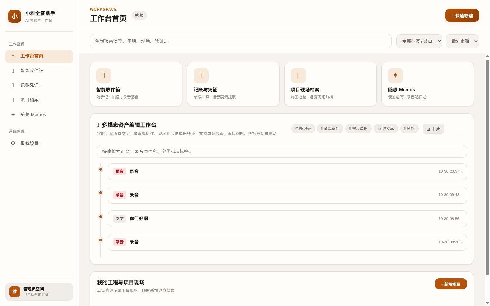
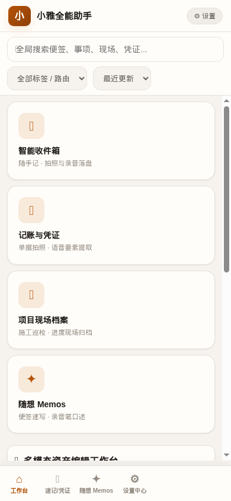
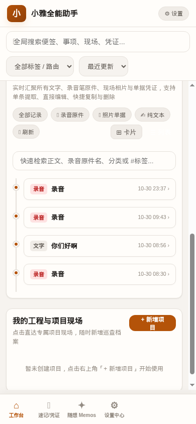

# 小雅全能助手 · 个人多模态工作台 (Personal Secretary)

面向个人、家庭与工程现场的多模态智能工作台。支持文字、语音口述、拍照凭证等多模态数据即时采集、私有化安全落盘与全功能编辑，融合极简美学与高可用自适应架构。

---

## 📸 界面效果预览

### 电脑端宽屏工作台 (Desktop UI)
固定侧边导航、多模态金刚区、全量时间线与卡片自由切换、单条资产快捷操作栏：


### 手机端自适应排版 (Mobile UI)
自动识别屏幕尺寸、旋转与视口高度（动态 `--vh` 防遮挡），顶部毛玻璃 Header 与底部悬浮导航，时间线极简聚合：
<p align="center">
  
  &nbsp;&nbsp;&nbsp;&nbsp;
  
</p>

---

## 🌟 核心特性与架构亮点

1. **自动识别与自适应手机屏幕排版**：
   - 监听 `visualViewport` 与动态视口高度，解决 iOS Safari 与安卓 Chrome 底部工具栏、全面屏手势条及虚拟键盘遮挡变形问题；
   - 极简自适应时间线流：针对移动设备优化，录音仅显示“**录音**”，图片仅显示“**图片**”，文字显示前 **8 个字**（后接 `...`），单行紧凑美观；
   - 点开任一条目即可呼出全功能详情模态框，提供全文浏览、原音频在线试听/下载、单条编辑修改、一键复制及快捷删除；
   - 所有录音原件在卡片与详情弹窗中**自动显示语音转写/识别文本**。

2. **多模态全场景录入与私有落盘**：
   - **智能收件箱**：随手记、录音与拍照凭证落盘；
   - **记账与凭证**：单据拍照、语音要素提取与自动分类；
   - **工程现场巡检**：施工进度巡查、多媒体原件存证；
   - **随想 Memos**：灵感便签速写、#标签自动聚合；
   - **微信同款交互**：内置 88px 麦克风长按录音、动态音频波形 HUD 弹窗。

3. **双重视图模式无缝切换**：
   - **⊞ 卡片模式**：大图瀑布流、完整内容预览、音频播放器内嵌；
   - **☰ 列表时间线**：垂直时间轴串联、极简摘要、点击展开。

4. **隐私安全与生产数据隔离**：
   - 用户所有多媒体资产文件（`.webm`, `.mp3`, `.wav`, `.jpg`, `.png`）严格存储在私有目录，不进版本库；
   - 生产环境凭据通过动态环境变量或独立配置载入，代码库 100% 干净脱敏。

---

## 🛠 部署配置要求与环境准备

### 硬件与系统要求
- **最低配置**：1 核 CPU / 512MB 内存 / 1GB 可用磁盘空间；
- **推荐配置**：2 核 CPU / 2GB+ 内存（用于存储更多录音原件与巡检照片）；
- **支持操作系统**：Linux (Ubuntu / Debian / CentOS / fnOS 飞牛私有云 / Alpine), macOS, Windows 10/11；
- **网络需求**：支持外网访问推荐使用 Cloudflare Tunnel、Tailscale 或反向代理服务（Nginx）。

### 软件运行依赖
- **Python**：Python 3.8 或更高版本（内置标准库 `http.server`, `urllib`, `json`, `os`，无需复杂三方包）；
- **前端运行**：现代浏览器（iOS Safari 14+ / Chrome 80+ / Edge / Firefox），需支持 Web Audio API 与 MediaRecorder。

---

## 🚀 详细部署方法

### 方式一：单文件/极简原生启动 (推荐)

1. **克隆代码仓库**：
   ```bash
   git clone <仓库地址> personal-secretary
   cd personal-secretary
   ```

2. **启动本地服务**：
   ```bash
   python3 server.py --port 18765
   ```
   *服务将自动在本地端口 `18765` 启动，并在同级目录自动创建 `data/`、`web/` 存储多模态数据与前端文件。*

3. **访问系统**：
   - 局域网访问：`http://<主机局域网IP>:18765`
   - 本机访问：`http://127.0.0.1:18765`

---

### 方式二：外网穿透与固定域名访问 (Cloudflare Tunnel)

若需在手机端公网随时随地安全访问：

1. **配置 cloudflared 穿透**：
   ```bash
   # 安装 cloudflared 后配置 ingress 指向本地 18765 端口
   cloudflared tunnel run <TUNNEL_NAME_OR_ID>
   ```

2. **配置 SSL 与公网域名**：
   - 将子域名（如 `m.yourdomain.com`）解析至 Cloudflare Tunnel；
   - 开启 Full (Strict) SSL，即可在手机端享受纯净 HTTPS 安全录音环境（浏览器对 HTTP 限制麦克风权限，必须启用 HTTPS）。

---

### 方式三：守护进程常驻运行 (Systemd)

在 Linux 服务器中创建服务文件 `/etc/systemd/system/personal-secretary.service`：
```ini
[Unit]
Description=Personal Secretary Multi-modal Assistant
After=network.target

[Service]
Type=simple
User=root
WorkingDirectory=/vol1/1000/personal-secretary
ExecStart=/usr/bin/python3 /vol1/1000/personal-secretary/server.py --port 18765
Restart=always
RestartSec=5

[Install]
WantedBy=multi-user.target
```
```bash
sudo systemctl daemon-reload
sudo systemctl enable --now personal-secretary
```

---

## 📜 往期所有版本更新记录 (Changelog)

所有历史版本的详细改动均永久沉淀在 `CHANGELOG.md` 中，并在 Git Commit 历史中严格按语义化版本追踪：

- [👉 查看往期所有版本与更新细节 (CHANGELOG.md)](CHANGELOG.md)

---

## 📄 开源与协议
本项目采用 MIT 许可证。
